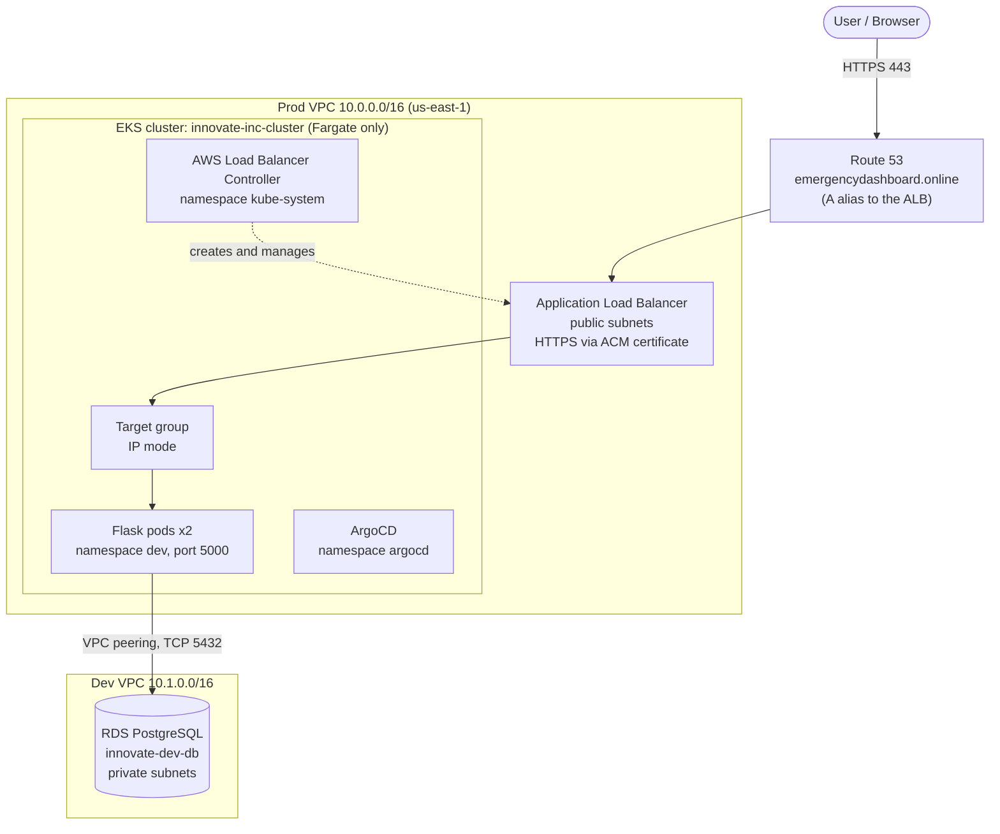
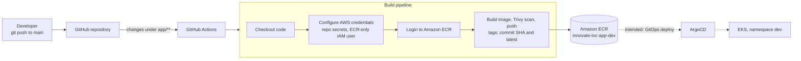

# innovate-inc-aws-infra

Infrastructure-as-code and application code for **Innovate Inc**, a production-style cloud platform on AWS. It runs a containerised Flask service on Amazon EKS (Fargate), fronted by an HTTPS Application Load Balancer, backed by PostgreSQL on RDS, built and shipped through a GitHub Actions to Amazon ECR pipeline, with audit, compliance and cost guardrails around it.

> **Status as of 27 October 2026:** Phases 1 to 4 are built and verified. The live application is reachable over HTTPS. GitOps delivery with ArgoCD is installed but **not yet functional** (see [Known issues](#12-known-issues-and-current-limitations)). Phases 5 to 7 have not started.

---

## Table of contents

1. [Project overview](#1-project-overview)
2. [Architecture](#2-architecture)
3. [CI/CD flow](#3-cicd-flow)
4. [Technology stack](#4-technology-stack)
5. [Phase-by-phase status](#5-phase-by-phase-status)
6. [Network design](#6-network-design)
7. [Repository layout](#7-repository-layout)
8. [How to deploy](#8-how-to-deploy)
9. [Operating and verifying](#9-operating-and-verifying)
10. [Security notes](#10-security-notes)
11. [Cost](#11-cost)
12. [Known issues and current limitations](#12-known-issues-and-current-limitations)
13. [Lessons learned](#13-lessons-learned)
14. [Roadmap](#14-roadmap)

---

## 1. Project overview

The project started from an enterprise multi-account AWS reference diagram (management, CI/CD, dev, staging and production accounts, each with its own EKS cluster) and deliberately **simplified it to a single AWS account** to cut cost by roughly 40% and reduce operational overhead.

| Original design | What was built |
|---|---|
| Separate AWS accounts per environment | One account; environments separated by **VPC** (and, later, Kubernetes namespaces) |
| One EKS cluster per environment | **One shared EKS cluster** |
| EC2 managed node groups | **Fargate only** (serverless pods, no nodes to manage) |
| IAM Identity Center and AWS Organizations | A scoped IAM user for Terraform and a separate, ECR-only IAM user for CI |

**Trade-off to be aware of:** with one account, the isolation between dev, staging and prod is weaker than the account boundary in the original design. RBAC and Kubernetes NetworkPolicies become the main isolation mechanism and must be designed carefully before staging and prod workloads are added.

**What the application does today:** a minimal Flask service (served by gunicorn on port 5000) exposing `/` and `/health`. It exists to prove the platform end to end: build, scan, publish, run, route, and reach a database over private networking.

---

## 2. Architecture



### Request path, hop by hop

1. **DNS:** `emergencydashboard.online` is a Route 53 alias record pointing at the ALB.
2. **ALB:** terminates TLS using an ACM certificate. The Ingress annotations configure an HTTP to HTTPS redirect. The ALB sits in the prod VPC's public subnets.
3. **Target group:** created and managed by the AWS Load Balancer Controller in **IP mode**, so traffic goes straight to pod IPs.
4. **Pods:** two replicas of the Flask app run on Fargate in the prod VPC's private subnets (namespace `dev`).
5. **Database:** the RDS instance lives in the **dev VPC**. Pods reach it through a **VPC peering connection**, and the RDS security group allows TCP 5432 from the prod VPC CIDR (`10.0.0.0/16`).

### Why the cluster is in the prod VPC but the database is in the dev VPC

The EKS cluster and its Fargate profiles were created in the prod VPC. The dev database was created in the dev VPC. Rather than rebuild either, the two VPCs were **peered** with routes in both directions. This works, but it is a known departure from the ideal layout (see roadmap).

---

## 3. CI/CD flow



- **Implemented and working:** GitHub Actions builds the image from `app/`, scans it with Trivy, and pushes it to ECR. The workflow file lives in `.github/workflows/`; read it for the exact step order and the scan failure policy.
- **Intended but not yet working:** ArgoCD watching this repository and deploying to the cluster. Today the workloads in `dev` are **not** being delivered by ArgoCD (see [Known issues](#12-known-issues-and-current-limitations)).
- **Credentials:** the pipeline authenticates with an IAM user restricted to ECR push and pull on the three app repositories. Its keys are stored as GitHub Actions repository secrets (`AWS_ACCESS_KEY_ID`, `AWS_SECRET_ACCESS_KEY`), never in the repository.

---

## 4. Technology stack

| Area | Technology |
|---|---|
| Cloud | AWS, single account, region `us-east-1` |
| Infrastructure as code | Terraform (AWS provider 5.x), remote state in S3 with DynamoDB locking |
| Kubernetes | Amazon EKS on Fargate, CoreDNS add-on, AWS Load Balancer Controller (Helm, IRSA) |
| GitOps | ArgoCD |
| Containers | Docker, Amazon ECR (three repositories with a keep-last-10 lifecycle policy) |
| CI | GitHub Actions, Trivy image scanning |
| Application | Python, Flask, gunicorn |
| Data | Amazon RDS for PostgreSQL |
| Edge and DNS | Application Load Balancer, ACM certificate, Route 53 |
| Governance | CloudTrail, AWS Config, AWS Budgets |

---

## 5. Phase-by-phase status

| Phase | Scope | Status |
|---|---|---|
| 1. Foundation | CloudTrail (multi-region, log validation), AWS Config recorder, AWS Budgets alerts | Complete |
| 2. Networking | Three VPCs, subnets, NAT gateways, route tables, dev to prod VPC peering | Complete |
| 3. CI/CD | ECR repositories, GitHub Actions build and push, Trivy scanning, scoped CI IAM user | Complete (image publishing); ArgoCD delivery not working |
| 4. Compute and data | EKS on Fargate, load balancer controller, HTTPS ingress, RDS PostgreSQL, ArgoCD install | Mostly complete (dev only) |
| 5. Production hardening | WAF, Shield, Secrets Manager, Client VPN | Not started |
| 6. Static frontend | S3 bucket and CloudFront for a React SPA | Not started |
| 7. Monitoring integration | CloudWatch alarms feeding an alerting pipeline | Not started |

### Phase 1: Foundation (`terraform/foundation`)
- CloudTrail trail with a dedicated, non-public S3 log bucket.
- AWS Config recorder and delivery channel with its own log bucket and IAM role.
- A monthly cost budget with notifications at 20%, 60% and 100% of the limit.

### Phase 2: Networking (`terraform/networking`)
- A reusable **VPC module** (`modules/vpc`) instantiated three times.
- Each VPC has two public and two private subnets across two Availability Zones, an internet gateway, one NAT gateway and separate public and private route tables.
- `peering.tf` creates the prod to dev peering connection and the routes on both sides.

### Phase 3: CI/CD (`terraform/cicd`, `.github/workflows`)
- ECR repositories `innovate-inc-app-dev`, `-staging` and `-prod`, with image scanning on push.
- An IAM user and policy limited to ECR push and pull on those repositories.
- The GitHub Actions workflow that builds and publishes the Flask image.

### Phase 4: Compute and data
- **EKS cluster** `innovate-inc-cluster` in the prod VPC, running **Fargate only** with profiles for the `kube-system`, `dev` and `argocd` namespaces.
- **CoreDNS** add-on, required for in-cluster DNS on Fargate.
- **AWS Load Balancer Controller** installed with Helm and an IAM role bound through the cluster's OIDC provider (IRSA).
- **Ingress** (`k8s/dev-ingress.yaml`): internet-facing ALB, HTTP and HTTPS listeners, ACM certificate, host rule for `emergencydashboard.online`, IP target type.
- **RDS PostgreSQL** `innovate-dev-db` in the dev VPC's private subnets.
- **ArgoCD** installed in the `argocd` namespace.

---

## 6. Network design

| Environment | VPC CIDR | Contains today |
|---|---|---|
| Prod | `10.0.0.0/16` | EKS cluster, Fargate pods, ALB |
| Dev | `10.1.0.0/16` | RDS PostgreSQL |
| Staging | `10.2.0.0/16` | Networking only (nothing deployed) |

- Public subnets host the ALB. Private subnets host Fargate pods and the database. Private subnets reach the internet through the VPC's NAT gateway.
- **Peering:** prod and dev are peered. Route table entries exist in both private route tables, and the RDS security group allows `10.0.0.0/16` on port 5432.
- **Subnet tags:** the public subnets carry `kubernetes.io/role/elb` and `kubernetes.io/cluster/innovate-inc-cluster` so the load balancer controller can discover them. These tags were added outside Terraform, so the VPC module uses `lifecycle { ignore_changes = [tags, tags_all] }` on subnets to stop Terraform from removing them.
- **Routes:** the NAT route is a standalone `aws_route` resource. Do not reintroduce an inline `route {}` block on the private route tables, because it conflicts with the peering routes (see [Lessons learned](#13-lessons-learned)).

---

## 7. Repository layout

```
innovate-inc-aws-infra/
├── .github/workflows/        GitHub Actions: build, scan and push to ECR
├── app/                      Flask application, requirements.txt, Dockerfile
├── eks/
│   └── cluster-config.yaml   eksctl cluster definition (see drift note below)
├── k8s/
│   ├── flask-app-dev.yaml    Deployment and Service for the app (namespace dev)
│   ├── dev-ingress.yaml      ALB Ingress: HTTPS, ACM cert, host rule
│   ├── argocd-flask-app.yaml ArgoCD Application definition
│   ├── namespaces.yaml       Namespace definitions
│   ├── network-policy.yaml   NetworkPolicy manifests
│   ├── alb-trust-policy.json IAM trust policy for the load balancer controller
│   ├── argocd/               ArgoCD-related manifests
│   └── namespaces/           Per-namespace manifests
└── terraform/
    ├── foundation/           CloudTrail, AWS Config, Budgets
    ├── networking/           VPC module, three VPCs, peering
    ├── cicd/                 ECR repositories, CI IAM user and policy
    ├── database/             RDS PostgreSQL and its subnet group
    ├── ingress/              Supporting resources for the load balancer controller
    ├── compute/              Reserved (not yet used)
    ├── data/                 Reserved (not yet used)
    └── security/             Reserved (not yet used)
```

> **Drift note:** `eks/cluster-config.yaml` may still describe the original plan (a managed node group of `t3.medium` nodes). The live cluster is **Fargate only** with no node group, and its Fargate profiles were created separately. Reconcile this file with the live cluster before using it to recreate the cluster.

---

## 8. How to deploy

### Prerequisites
- An AWS account and an IAM user for Terraform with sufficient permissions.
- Installed locally or on a build host: AWS CLI v2, Terraform, kubectl, eksctl, Helm, Docker, Git, GitHub CLI.
- A domain in Route 53 and an issued ACM certificate in the same region as the ALB (for HTTPS).
- EC2 vCPU quota large enough for any instances you launch (new accounts can start with a very low default).

### 1. Create the Terraform state backend (one time, manual)
This cannot be managed by the Terraform that depends on it.

```bash
aws s3api create-bucket --bucket innovate-inc-tfstate-<ACCOUNT_ID> --region us-east-1
aws s3api put-bucket-versioning --bucket innovate-inc-tfstate-<ACCOUNT_ID> \
  --versioning-configuration Status=Enabled
aws s3api put-bucket-encryption --bucket innovate-inc-tfstate-<ACCOUNT_ID> \
  --server-side-encryption-configuration \
  '{"Rules":[{"ApplyServerSideEncryptionByDefault":{"SSEAlgorithm":"AES256"}}]}'
aws dynamodb create-table --table-name innovate-inc-tflock \
  --attribute-definitions AttributeName=LockID,AttributeType=S \
  --key-schema AttributeName=LockID,KeyType=HASH \
  --billing-mode PAY_PER_REQUEST --region us-east-1
```

Each `backend.tf` hardcodes the bucket name, so replace the account ID there with your own. Terraform currently prints a deprecation warning for `dynamodb_table`; the newer `use_lockfile` option is the replacement.

### 2. Apply Terraform in dependency order
For each directory, run `terraform init`, `terraform plan`, review, then `terraform apply`:

1. `terraform/foundation`
2. `terraform/networking`
3. `terraform/cicd`
4. After the cluster exists: `terraform/ingress`, then `terraform/database`

Review every plan before applying. In particular, a plan that wants to **remove tags** from the public subnets or **remove peering routes** is wrong; stop and fix the configuration first.

### 3. Create the EKS cluster
Run long commands inside `tmux` so an SSH drop does not kill them.

```bash
tmux new -s eks
eksctl create cluster -f eks/cluster-config.yaml   # review the drift note first
```

Then make sure the cluster has what a Fargate-only cluster needs:
- A Fargate profile for each namespace that will run pods (`kube-system`, `dev`, `argocd`).
- The **CoreDNS** add-on, running on Fargate. Without it nothing in the cluster can resolve DNS.

### 4. Install the AWS Load Balancer Controller
Install the chart from `https://aws.github.io/eks-charts` into `kube-system` with `clusterName`, `region`, an IRSA-annotated service account, and **`vpcId` set to the VPC the cluster runs in** (the prod VPC). A wrong `vpcId` makes ALB creation fail with a "security groups are invalid" error.

### 5. Deploy the application and ingress
```bash
kubectl apply -f k8s/namespaces.yaml
kubectl apply -f k8s/flask-app-dev.yaml
kubectl apply -f k8s/dev-ingress.yaml
```

### 6. Configure CI
Add `AWS_ACCESS_KEY_ID` and `AWS_SECRET_ACCESS_KEY` (for the ECR-only IAM user) as repository secrets. Pushes to `main` that touch `app/**` then build and publish the image.

---

## 9. Operating and verifying

### Quick health check
```bash
aws eks describe-cluster --name innovate-inc-cluster --query cluster.status --output text
kubectl get pods -A | grep -v Running          # an empty result is healthy
kubectl get ingress -n dev                     # ADDRESS should be populated
aws rds describe-db-instances --db-instance-identifier innovate-dev-db \
  --query "DBInstances[0].DBInstanceStatus" --output text
aws ec2 describe-vpc-peering-connections --query "VpcPeeringConnections[].Status.Code" --output text
curl -s https://emergencydashboard.online/health   # {"status":"healthy"}
```

### Troubleshooting checklist
| Symptom | First things to check |
|---|---|
| Pods cannot resolve DNS, or controllers time out calling AWS STS | Is the CoreDNS add-on installed, and are its pods `Running` on Fargate? |
| Ingress has no `ADDRESS` | `kubectl describe ingress`, then the controller logs. Check the controller's `--aws-vpc-id`, the subnet tags, and IAM role trust. |
| `DuplicateTargetGroupName` in controller events | A stale target group from an earlier failed attempt exists. Delete it and let the controller recreate it. |
| Terraform plan wants to strip subnet tags or peering routes | Confirm the VPC module still has `ignore_changes` on subnet tags and no inline `route {}` on private route tables. |
| Terraform says a route already exists | Import it: `terraform import '<resource>' <route-table-id>_<cidr>` |
| ArgoCD pod crash-loops with `no matches for kind "ApplicationSet"` | The ApplicationSet CRD is missing. Install it with `kubectl apply --server-side --force-conflicts` (the plain apply can fail on annotation size). |
| `Permission denied (publickey)` on SSH from Windows | The `.pem` file has permissions that are too open; remove extra ACL entries so only your user can read it. |

---

## 10. Security notes

- **No secrets in the repository.** AWS keys, tokens and database credentials must never be committed. CI credentials live in GitHub Actions secrets; state lives in a private, versioned, encrypted S3 bucket.
- **Least privilege for CI.** The pipeline's IAM user can only push and pull on the three ECR repositories.
- **Rotate on exposure.** Any access key or token that appears in a log, screenshot or chat should be treated as compromised and rotated immediately. Several keys were rotated this way during the build.
- **Private data tier.** RDS sits in private subnets with no public access; its security group allows only the prod VPC CIDR on port 5432.
- **Audit and compliance.** CloudTrail is multi-region with log file validation; AWS Config records resource changes.
- **Image scanning.** ECR scans on push and the pipeline runs Trivy.
- **Planned hardening (Phase 5):** WAF and Shield in front of the ALB, Secrets Manager for credentials, Client VPN for private access.
- **Before making this repository public:** review `terraform/database` and all manifests for hardcoded credentials, and consider whether the domain, certificate ARN and resource identifiers in `k8s/` should be parameterised.

---

## 11. Cost

The target for this single-account design is roughly **$350 to $500 per month**. Early billing in October 2026 (first five days) was about $105 estimated, dominated by EKS, with NAT gateways, RDS and a small build host also running continuously.

Main cost drivers:
- EKS control plane and Fargate pod usage.
- Three NAT gateways (one per VPC). Staging has no workloads, so its NAT gateway is the easiest saving if needed.
- RDS instance hours.

An AWS Budgets alert is configured at 20%, 60% and 100% of a $500 monthly limit.

---

## 12. Known issues and current limitations

1. **ArgoCD is not delivering the application.**
   - The `innovate-flask-app` Application was created with a **placeholder repository URL**, so ArgoCD cannot read this repository and its sync status is `Unknown`.
   - The repository is private, so ArgoCD also needs read-only repository credentials.
   - The Application has automated sync with **prune and self-heal enabled**. Before pointing it at this repository, disable automation and confirm that everything running in `dev` is represented in the synced path, otherwise ArgoCD would delete it.
   - The Application's source path is the whole `k8s/` folder, which also contains non-app files (an IAM policy JSON, namespace and network policy manifests, the Application definition itself). The app manifests should move to a dedicated folder before syncing.
2. **ArgoCD ApplicationSet controller** crash-loops when the ApplicationSet CRD is missing. Verify with `kubectl get crd | grep argoproj` that `applicationsets.argoproj.io` exists and that the controller stays up for several minutes.
3. **Only the `dev` workload exists.** Staging and prod namespaces, per-environment databases, and ElastiCache for the prod session layer are not created.
4. **Database wiring is not finished.** Network connectivity from pods to RDS is verified; supplying credentials to the application (via Secrets Manager) and using the database from code are future work.
5. **VPC layout is not ideal.** The cluster lives in the prod VPC while the only database lives in the dev VPC, bridged by peering.
6. **Configuration drift.** `eks/cluster-config.yaml` may not match the live Fargate-only cluster.
7. **Single point of failure for build and operations.** Day-to-day operations were run from one EC2 build host; anything not committed to this repository exists only there.

---

## 13. Lessons learned

These are real faults found while building this platform. They are recorded because each one cost time and none was obvious from the first symptom.

| Problem | Root cause | Fix |
|---|---|---|
| Load balancer never got an address; controller logged STS timeouts | No CoreDNS in the cluster, so DNS did not work anywhere | Installed the `coredns` add-on |
| ALB creation rejected: "One or more security groups are invalid" | Controller was installed with the **wrong VPC ID** | `helm upgrade --reuse-values --set vpcId=<correct VPC>` and restart |
| `DuplicateTargetGroupName` | Stale target group left by an earlier failed attempt | Deleted the target group; controller recreated it |
| Terraform wanted to remove peering routes on every plan | Inline `route {}` block and standalone `aws_route` resources both managed the same route table | Made NAT a standalone `aws_route`, added `ignore_changes = [route]`, imported existing routes |
| Terraform wanted to remove subnet tags the load balancer controller needs | Tags were added outside Terraform | `ignore_changes = [tags, tags_all]` on subnets |
| ArgoCD controller crash loop | `ApplicationSet` CRD missing; a plain `kubectl apply` of the CRD did not take | Server-side apply of the CRD |
| An incomplete `eksctl create cluster` run | SSH session dropped mid-provisioning | Run long commands in `tmux`; check which add-ons actually exist afterwards |
| Declared a fix successful too early | A crashing pod looked healthy for its first two minutes | Wait several minutes, and verify the underlying object (for example the CRD), not only pod state |

---

## 14. Roadmap

- **Fix GitOps:** correct the ArgoCD Application's repository URL, add read-only repo credentials, move app manifests to their own folder, disable pruning until verified, then re-enable.
- **Phase 5:** WAF and Shield, Secrets Manager for database credentials, Client VPN.
- **Environments:** create `staging` and `prod` namespaces with RBAC and NetworkPolicies, per-environment RDS, and ElastiCache for the prod session layer.
- **Layout cleanup:** consider moving the database into the same VPC as the cluster and removing the peering dependency.
- **Phase 6:** React single-page app on S3 and CloudFront.
- **Phase 7:** CloudWatch alarms integrated with an alert triage and notification pipeline.
- **Housekeeping:** reconcile `eks/cluster-config.yaml` with the live cluster, bring Fargate profiles and add-ons under code, switch Terraform locking to `use_lockfile`, extend the CI pipeline to push to the staging and prod repositories.
# CI Pipeline Test
